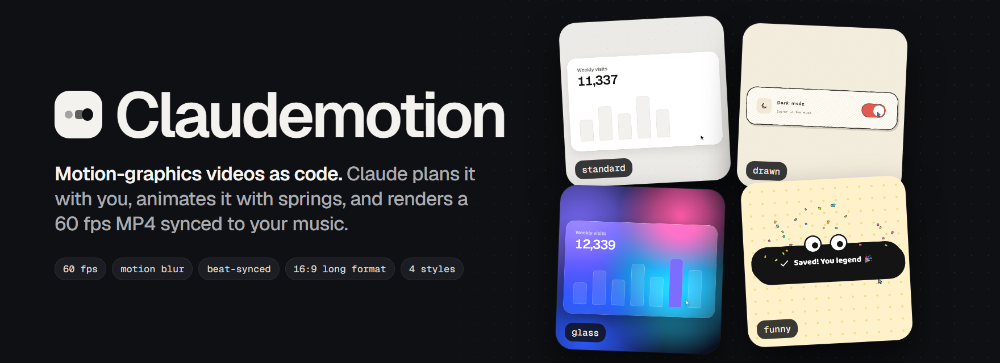
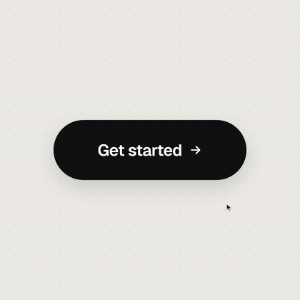
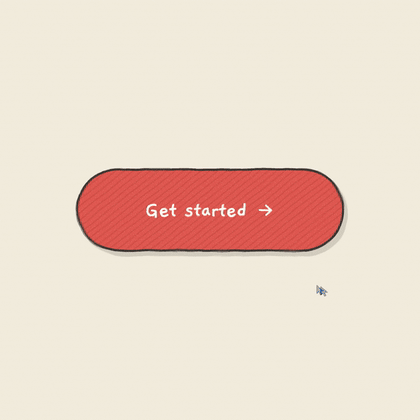
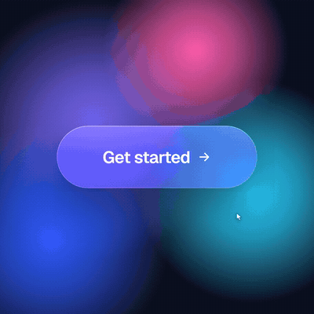
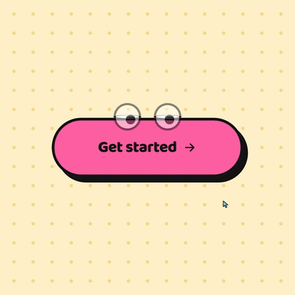
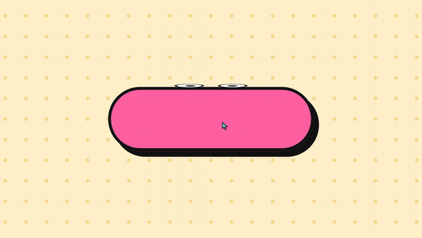

<p align="center">
  
</p>

<p align="center">
  <a href="#-quickstart"></a>
  
  
  
</p>

<p align="center">
  <b>Tell Claude what the video is about. Get a Dribbble-level motion video back.</b><br>
  One morphing shape · closed-form springs · a cursor that really clicks · UI sounds on the beat · rendered to MP4
</p>

<p align="center">
  <a href="#-see-it-move">Gallery</a> ·
  <a href="#-quickstart">Quickstart</a> ·
  <a href="#-how-it-works">How it works</a> ·
  <a href="#-styles">Styles</a> ·
  <a href="#-commands">Commands</a> ·
  <a href="#-faq">FAQ</a>
</p>

---

## 🎬 See it move

Same page, same timeline - four completely different looks. Switch with one parameter.

<table>
  <tr>
    <td align="center" width="50%"><br><b>standard</b><br><sub>Dribbble-level UI motion · warm gray · calm springs</sub></td>
    <td align="center" width="50%"><br><b>drawn</b><br><sub>colored pencil on paper · boiling outlines · 24 fps feel</sub></td>
  </tr>
  <tr>
    <td align="center"><br><b>glass</b><br><sub>frosted panels over drifting light · soft and calm</sub></td>
    <td align="center"><br><b>funny</b><br><sub>squash & stretch · googly eyes · confetti · jokes</sub></td>
  </tr>
</table>

### Long format, 16:9

For explainers, launches and walkthroughs: 1920×1080 at 60 fps, scenes timed in seconds, beat sync optional.

<p align="center"></p>

<sub>GIFs are downscaled previews. Real renders are 1440×1440 or 1920×1080 MP4 at 60 fps with motion blur and sound.</sub>

---

## ⚡ Quickstart

```bash
# 1. install
claude plugin marketplace add eronbubi/ClaudemotionPlugin
claude plugin install claudemotion@claudemotion-local
```

Then, in a new Claude Code session inside an empty folder:

```text
/claudemotion:setup                 # checks your tools, sets the folder up as a video project
/claudemotion:new launch video for my app
```

Claude asks before it builds anything - format, style, content, colors, song, length, end card - shows you the plan on the beat grid, and only then animates and renders. The finished MP4 lands in your **Downloads** folder.

> 💡 You can also just say *"make a promo video for …"* - the skill picks it up on its own.

---

## 🧠 How it works


Every video is a web page where **every pixel is a pure function of time**. No CSS transitions, no timers, no state between frames - so any frame can be rendered in any order, by four workers at once, and the loop closes perfectly.

### What makes it look expensive

| | |
|---|---|
| 🌀 **One shape, never cut** | Every state is the same element morphing size, radius and color while its content swaps with its own enter and exit timing. |
| 🧮 **Closed-form springs** | A value that changes target ten times is the sum of ten spring step responses - still a pure function of time. |
| ↔️ **Two-spring edges** | Tab indicators and toggle knobs stretch: the leading edge rides a stiffer spring than the trailing one. |
| 🖱️ **A cursor that really clicks** | Mouse-down 70 ms before the beat, up on the beat. Drags are direct manipulation with rubber-banding. |
| 🎥 **Camera** | Zooms so every state fills the frame, kicks on impacts. |
| 💨 **Real motion blur** | 4 subframes per frame with a 180° shutter, blended by ffmpeg `tmix`. |
| 🥁 **Sound on the beat** | Beat grid from spectral flux, verified against measured transients; every UI sound is placed by its own peak. |
| 🔁 **Perfect loops** | Frame 0 equals frame T - pixel diff 0, cursor position and speed included. Checked automatically. |

### 🎲 Never the same video twice

Every video gets its own concept: Claude picks an **archetype**, an **opener**, a **camera language** and an **ending**, checks what the last videos used, and offers you 2-3 contrasting concepts before it plans anything.

| Archetypes | Openers | Camera |
|---|---|---|
| walkthrough · problem → solution · kinetic type · countdown · data story · montage · zoom-through · character · versus · teaser / reveal · tutorial · quote | cold open on the result · bold statement · question · number slam · problem state · mystery · logo build · mid-action · sound-led · notification · zoom-out · cursor click | zoom-to-fit · push-in · pan along a strip · whip pan · locked-off · zoom-through · parallax · tilt & shake |

A small history (`~/.claudemotion/history.json`) remembers the last videos, so the same opener or story shape never comes twice in a row.

---

## 🎨 Styles

| Style | Looks like | Moves like | Font | Signature sounds |
|---|---|---|---|---|
| **standard** | warm-gray canvas, white cards, black ink, one accent | tiny overshoot at most, 5 px blur swaps | Geist | click · toggle · whoosh |
| **drawn** | colored pencil on paper, hatching, wobbly outlines that boil | animated on ones at 24 fps, little jumps | Gaegu | scribble · pop |
| **glass** | frosted glass over drifting violet, cyan and pink light | critically damped, soft 10 px blur swaps | Geist | chime |
| **funny** | loud colors, chunky outlines, hard shadows, polka dots | bouncy, squash & stretch, screen shake, confetti | Baloo 2 | boing · slide whistle |

Pages use CSS variables (`--ink`, `--accent`, `--surface` …), so one page renders in every style. Adding your own style is one file.

## 📐 Formats

| | Short | Long |
|---|---|---|
| Size | 1440 × 1440 | 1920 × 1080 (16:9) |
| Timing | beats of your song | seconds - beat sync optional |
| Ending | seamless loop | end card + music fade-out |
| Typical length | 8 - 30 s | 30 s - several minutes |
| Frame rate | 60 fps | 60 fps |

## 🧰 Commands

| Command | What it does |
|---|---|
| `/claudemotion:setup [style] [short\|long]` | Checks Python, numpy, Pillow, Playwright/Chromium and ffmpeg; creates `claudemotion.json`, `engine/`, `audio/`, `out/` and a demo page. |
| `/claudemotion:new <idea>` | Starts a video: questions → song analysis → plan → build → review → render → MP4. |
| `/claudemotion:styles [name]` | Shows the four styles or sets the project's default. |

Folders with a `claudemotion.json` load the video-session rules automatically at session start.

<details>
<summary><b>📜 The reference brief this was built from</b></summary>

<br>

> **Direction** - Dribbble-level UI motion. One shape, never cut: every state is the same element morphing its size, radius and color while its content swaps with a short blur. A cursor drives every change with real clicks and drags. Springs everywhere, a tiny overshoot at most. The camera zooms so each state fills the frame. The last frame is the first frame, so it loops.
>
> **Banned** - bouncy easing, particle bursts, glows, gradients on UI chrome, mismatched icon strokes, dead time, anything that looks like a template.
>
> **Build** - one HTML file, every style computed inside `seek(t)`; springs as closed-form step responses; two-spring edges; direct-manipulation drags; numpy beat grid; Playwright with 4 subframes and ffmpeg `tmix` at 60 fps; one frame per beat reviewed before the full render.

Full text: [`references/example-prompt.md`](plugins/claudemotion/skills/claudemotion/references/example-prompt.md). (The *funny* style deliberately breaks the "banned" list - that's the joke.)

</details>

---

## 🗂️ Under the hood

```text
plugins/claudemotion/
├── commands/                 /claudemotion:setup · :new · :styles
├── hooks/                    session-start: loads the rules in video folders
└── skills/claudemotion/
    ├── SKILL.md              the workflow Claude follows
    ├── references/           structures (archetypes, openers, camera), short & long workflows, styles, audio, gotchas
    ├── templates/
    │   ├── engine/engine.js  springs, tracks, morph, camera, cursor, presence
    │   ├── engine/styles/    standard · drawn · glass · funny
    │   └── demo.html         a complete example page
    └── scripts/
        ├── check_env.py      tool check with exact fix commands
        ├── analyze.py        beat grid, song structure, energy map
        ├── render.py         contact sheets, loop check, full render
        ├── sounds.py         16 synthesised UI sounds - no downloads
        ├── mix.py            song + sounds, grid verified against transients
        ├── mux.py            picture + sound → final MP4
        └── history.py        remembers past concepts so the next video is different
```

## ✅ Requirements

- [Claude Code](https://claude.com/claude-code)
- Python 3.9+ with `numpy`, `pillow`, `playwright` → `pip install numpy pillow playwright` and `python -m playwright install chromium`
- ffmpeg with libx264 on your PATH (Windows: `winget install Gyan.FFmpeg`)
- Node.js (for the session hook) and internet access for Google Fonts while rendering

`/claudemotion:setup` checks all of this and prints the exact fix for anything missing.

## ❓ FAQ

<details>
<summary><b>How long does a render take?</b></summary>
About 11 finished frames per second with 4 workers: a 30 s loop takes about 3 minutes, one minute of 16:9 about 5.5 minutes. Drafts with <code>--fps 30 --sub 2</code> are about 4× faster.
</details>

<details>
<summary><b>Can I use my own song?</b></summary>
Yes - any audio file, even the sound of a screen recording. Claude analyzes the tempo and structure and starts on a downbeat. Royalty-free tracks are safest for publishing; commercial songs may get claimed or muted on social platforms.
</details>

<details>
<summary><b>Does it invent content?</b></summary>
No facts are made up silently: Claude asks for names, numbers and the end card, and lists every placeholder it had to invent in its final report.
</details>

<details>
<summary><b>Why do very fast moves show faint copies?</b></summary>
That's the 4-subframe motion blur. 8 subframes halve the effect at double render time.
</details>

---

<p align="center">
  <sub>Built with Claude Code · rendered frame by frame · every pixel a function of time</sub>
</p>
